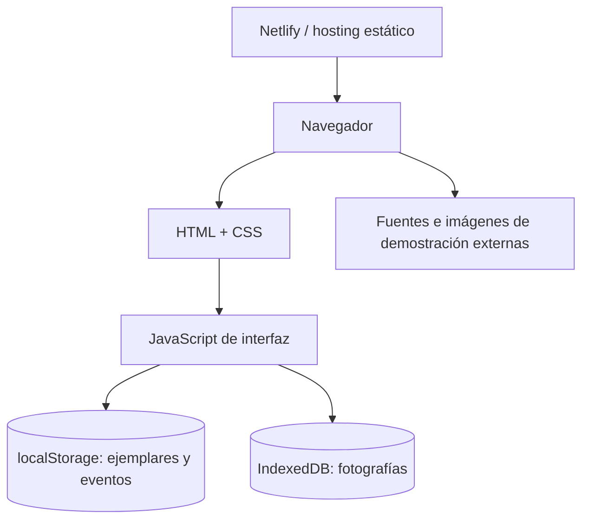
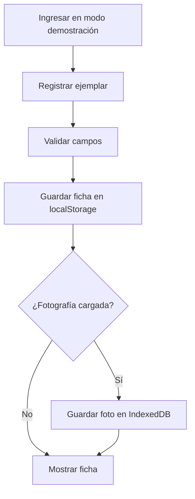
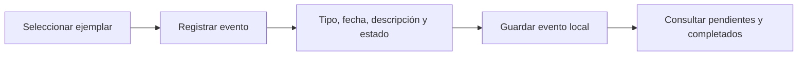

# Arquitectura de AGROPIDA

La aplicación es un prototipo **estático, cliente único por navegador**. Netlify entrega los archivos HTML, CSS, JS y recursos; el procesamiento sucede en el navegador.

## Registro de ejemplares

## Cuidados y seguimiento

**Límites actuales:** no hay API de autenticación, base de datos central, sincronización entre docentes, algoritmos BKT/mochila 0/1 integrados en este HTML, ni diagnóstico veterinario automático.
